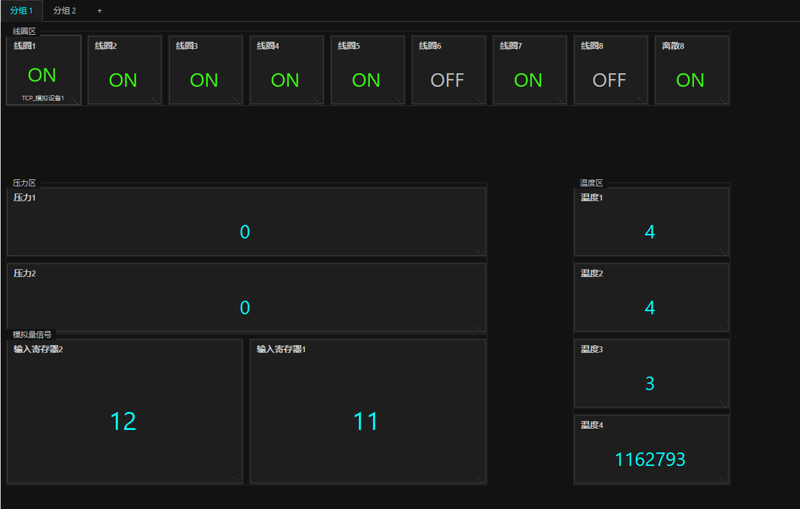
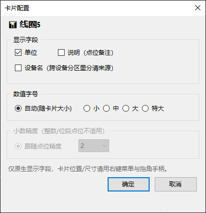
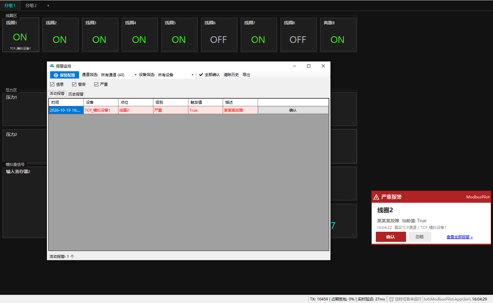
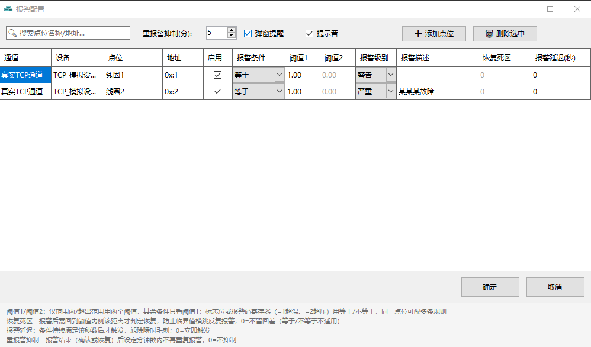
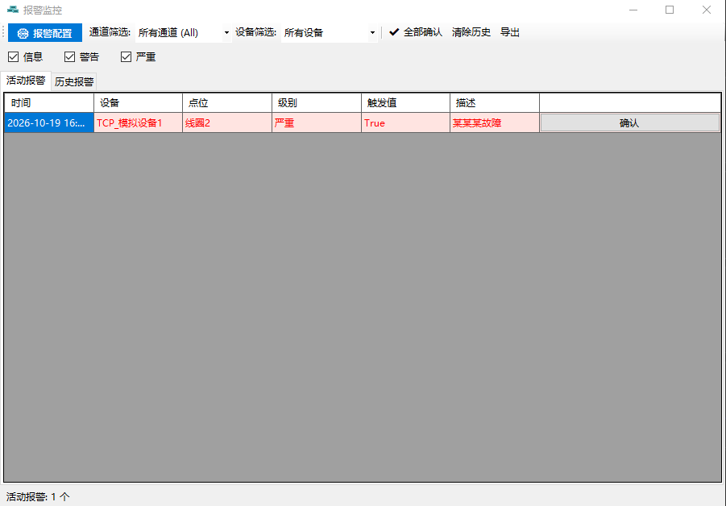
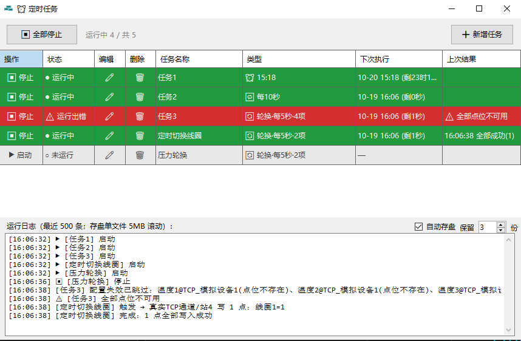
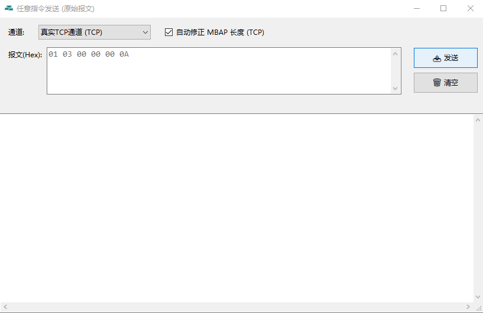
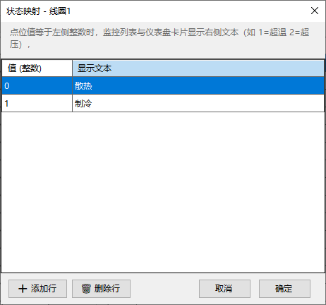
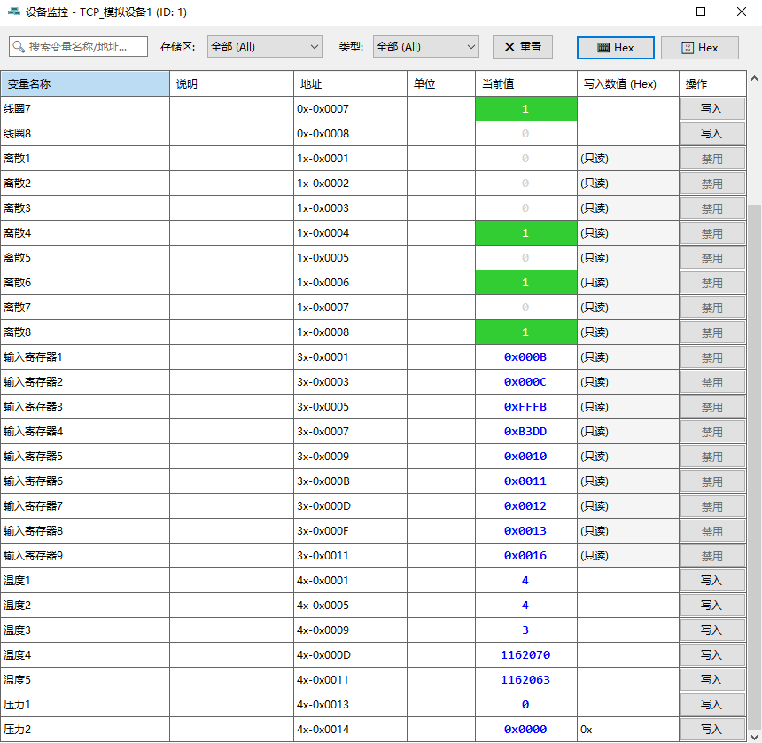

Here is the English version of your README file.

***

# 🚀 ModbusPilot

> [🇨🇳 中文](README.md) | [🇬🇧 English](README.en.md)

> **A Lightweight, Modern Modbus Master & Configuration Tool**
>
> *Designed by Zerosys Lab*

  

> ⚠️ **Intended Use**: ModbusPilot is a **debugging / testing / configuration tool** for developers and automation engineers working with Modbus devices during development. It is **not** designed, tested, or certified for industrial safety systems, life-critical systems, or production/commercial mission-critical control. Use in such environments is at your own risk — see the Disclaimer section near the bottom of this page.

## 📖 Introduction
ModbusPilot is a modern debugging tool designed for automation engineers. Built with **.NET 8 (WinForms)**, it moves away from the outdated interfaces of traditional tools, focusing on **"Lightweight Configuration"** and **"Automated Workflows"**.

No need to install massive SCADA systems; you can quickly build device monitoring dashboards with just a few drag-and-drop operations.

## 📚 Documentation
For detailed operation guides and configuration instructions, please refer to:
👉 **[ModbusPilot User Guide (UserGuide.en.md)](UserGuide.en.md)**

## ✨ Core Features (V1.1)

### Multi-Protocol & Multi-Device
Full support for Modbus RTU / TCP with auto-reconnection. One channel can carry several slaves, polled in a single schedule.

### Drag & Drop Dashboard
Directly drag points from the resource tree to generate visual dashboards.

### Dashboard Organization
Dashboard pages and per-page groups shown as top tab strips; phone-style free tile placement with whole-block reflow in narrow windows; GroupBox-style zone boxes with drag-follow ghosting.

Single-card display settings — unit, description, device name, font size and decimal precision:

### Alarm Monitoring
Multi-condition rules (>, <, =, ≠, in range, out of range) with per-point multiple rules, alarm delay and recovery deadband, corner popups with sound and a "recovered" state, dedicated monitor window with filtering and CSV export.

### Scheduled Tasks
Timed / interval / rotating write tasks across devices and points, per-task start & stop, live status coloring, auto-saved run logs, no catch-up writes after disconnects.

### Raw Command
Hand-craft raw frames and send them directly; automatic CRC (RTU) / MBAP length fix (TCP); frame consistency checks before sending.

### Display Enhancements
Dec/Hex switching, state text mapping (value → label), bit-field extraction, and 6-digit PLC address notation.

### Theming & Language
Built-in **Cyberpunk**, Industrial Grey, and Simple White themes; real-time switching between Chinese and English.

> Screenshots show the Chinese UI; the same features are available in the English interface.

## 📥 Download & Install
This software is portable (no installation required):
1.  Go to the [Releases](https://gitee.com/ZerosysLab/ModbusPilot/releases) page.
2.  Download the latest `ModbusPilot_v1.1.0_Win64.zip`.
3.  Unzip and double-click `ModbusPilot.exe` to run.

> **Note**: If you are unsure whether .NET 8 is installed on your computer, please download the **Self-Contained** version (larger file size but works out of the box).

## 🛠️ Development Environment
*   Visual Studio 2022
*   .NET 8.0 SDK
*   Windows Forms

## 🤝 Feedback
Feel free to submit [Issues](https://gitee.com/ZerosysLab/ModbusPilot/issues) for bug reports or feature requests.

## ⚠️ Disclaimer
ModbusPilot is a **debugging and configuration tool**, not an industrial-grade SCADA/control system. It is provided "AS IS" without warranty of any kind.

- **Not for safety-critical or life-critical use.** Do not use this software to control equipment where a malfunction could cause injury, death, or significant property/environmental damage (e.g. medical devices, nuclear, aerospace, weapons systems).
- **Not certified for industrial production control.** If you use it to monitor or write to real industrial/commercial equipment, thoroughly test offline first and take full responsibility for the outcome.
- The authors and contributors are not liable for any damages, downtime, data loss, or business interruption arising from the use of this software.

By using this software you agree to the above.

> **Licensing**: Starting with v1.1, ModbusPilot is **freeware** — every feature is free to use, but the source code is no longer public. Versions v1.0 and earlier were released under the MIT license and remain so; licenses already granted cannot be revoked retroactively.

---
**Copyright © 2026 Zerosys Lab.**