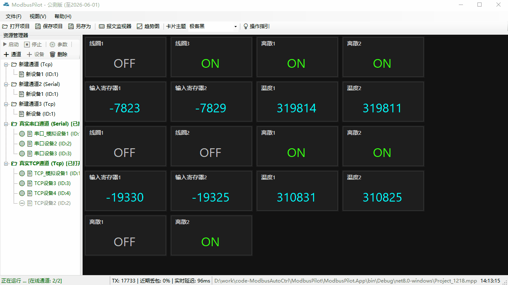
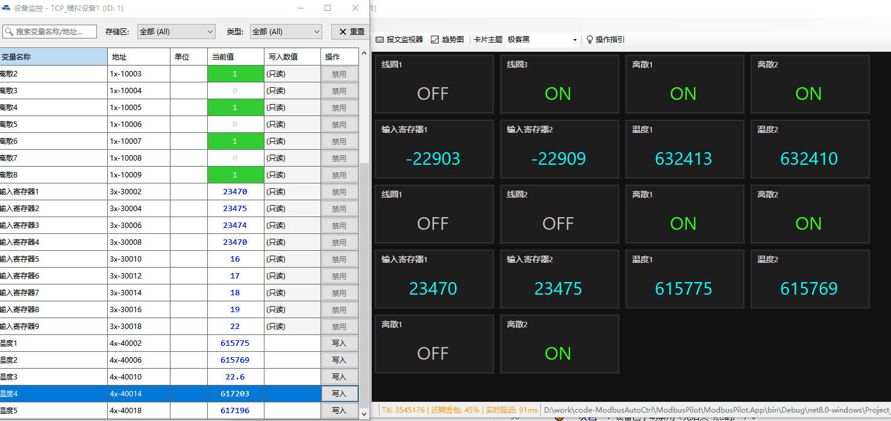

# 📘 ModbusPilot 使用手册 (User Guide)

> **适用平台**: Windows 10 / 11 (x64)

欢迎使用 **ModbusPilot**！这是一款基于 .NET 8 的现代化 Modbus 组态与调试工具，永久免费使用。本手册将指导您从零开始，快速搭建一套可视化的设备监控系统。

> ⚠️ **注意**：ModbusPilot 是一款调试/测试/配置工具，并非经过认证的工业控制或 SCADA 系统，请勿用于安全关键或生产环境的关键控制场景。使用前请阅读 [README.md](README.md) 中的免责声明。

---

## 1. 快速连接 (Connection)

### 1.1 创建通道 (Channel)
ModbusPilot 采用 **“通道 -> 设备 -> 点位”** 的三层拓扑结构。
1.  点击左上角工具栏的 **[➕ 添加通道]**。
2.  **选择通讯模式**：
    *   **Modbus TCP**: 适用于网口设备。输入目标 IP（如 `192.168.1.5`）和端口（默认 `502`）。
    *   **Modbus RTU**: 适用于串口/485设备。选择 COM 口、波特率、数据位、校验位。
    *   *提示：波特率与校验位必须与物理设备完全一致，否则无法通讯。*

### 1.2 添加设备 (Device)
1.  在左侧树状菜单中，选中刚才创建的通道。
2.  点击工具栏 **[➕ 添加设备]**。
3.  **设置站号 (Slave ID)**：
    *   Modbus 协议规定每个设备的 ID 必须唯一（范围 1~247）。
    *   *注意：同一通道下不能出现重复的 ID。*

### 1.3 启动通讯
选中通道或设备节点，点击工具栏的 **[▶ 启动]**。
*   🟢 **绿色**: 通讯正常，数据实时刷新。
*   🔴 **红色**: 通讯超时。请检查接线、防火墙或从站 ID 设置。
*   ⛔ **灰色**: 设备已手动禁用（见后文“热维护”）。

---

## 2. 点位配置与批量导入 (Configuration)

右键点击 **设备节点** -> 选择 **“⚙️ 修改配置”**，进入点位管理界面。

### 2.1 基础配置
*   **存储区 (Zone)**:
    *   `0x Coil Status` (线圈，读写)
    *   `1x Input Status` (离散输入，只读)
    *   `3x Input Register` (输入寄存器，只读)
    *   `4x Holding Register` (保持寄存器，读写)
*   **数据类型**: 支持 Bool, Int16, UInt16, Float32, Int32 等。
*   **大小端 (Endian)**: 处理多字节数据（如浮点数）时，若数据乱码，请尝试切换 `ABCD` / `CDAB` 等格式。

---

### 2.2 ⚡ 智能导入与批量操作 (Smart Import & Batch Edit)
拒绝繁琐的手动录入，通过智能化工具实现“分钟级”万点配置。

1.  **智能 Excel 导入 (Flexible Import)**:
    *   **不限模板**: 彻底打破“必须使用固定模板”的限制。支持导入任意格式的 Excel 点位表（各类 PLC 或 HMI 导出的原始表格均可）。
    *   **自定义映射**: 在导入向导中，系统会自动识别列名。您也可以手动调整**“Excel列”**与**“软件属性”**（名称、地址、类型、区域、备注）的对应关系，实现无缝数据迁移。

2.  **批量快捷操作 (Batch Actions)**:
    *   **一键递增**: 选中多个变量，支持**地址自动递增**（如 `40001` 自动变为 `40001, 40002, 40003...`）以及**名称序列化**（如 `Temp_#` 自动变为 `Temp_1, Temp_2...`）。
    *   **批量属性修改**: 支持多选变量后，**统一修改**数据类型（如全选改为 `Float32`）、大小端格式、读写权限或备注信息，配置效率提升 10 倍。

---

## 3. 卡片式监控 (Dashboard)

这是 ModbusPilot 的核心亮点——**拖拽式组态看板**。

### 3.1 创建监控卡片
只需三步，即可将枯燥的数据转化为可视化卡片：
1.  **打开监视器**：在左侧资源树中，**双击** 设备名称，打开该设备的实时数据表格。
2.  **选择变量**：在表格中找到您需要上墙的变量行。
3.  **拖拽生成**：按住该行不放，直接 **拖拽 (Drag)** 到右侧灰色的仪表盘区域，松手即生成卡片。

### 3.2 卡片交互类型
系统会自动根据变量类型生成对应的卡片：
*   **🔢 数值监视 (Monitor)**: 适用于所有只读或读写变量，实时显示数值与单位。
*   **🔘 开关控制 (Switch)**: 专用于 `0x 线圈`。点击卡片上的拨杆，即可直接下发 `ON/OFF` 指令。
*   **✍️ 数值写入 (Write)**: 专用于 `4x 保持寄存器`。在卡片输入框中填写数值，点击发送即可修改设备参数。

### 3.3 布局调整与全屏
*   **自由布局**: 按住卡片可随意**拖动位置**（手机桌面图标式）——拖到空白处就地落格、原有位置留空；拖到有卡片的格子上，该卡及后续卡片整块顺延让位。拖动中会实时显示半透明落点提示框。右键点击卡片可**移除**或**编辑**。
*   **卡片大小**: 拖动卡片右下角的手柄按整格缩放（宽 1~6 格 × 高 1~4 格）；右键菜单也有 小/宽/大/巨 四个快捷档。
*   **单卡显示配置**: 右键选择 **⚙ 卡片配置**，可分别设置单位/说明/设备名的显隐、数值字号与小数精度。
*   **📺 沉浸式全屏**:
    *   **快捷键**: 按下键盘 `F11` 进入/退出，`Esc` 可直接退出全屏。
    *   **鼠标操作**: 在仪表盘空白处 **右键 -> 进入全屏**。
    *   *说明: 全屏模式下将隐藏所有菜单栏与工具栏，提供纯净的监控体验，适合投屏展示。*

### 3.4 页与分组（v1.1 新增）
大型工程可以把画面拆成多个**页**，每页内再分多个**分组**：
*   **切页/切分组**: 顶部两排选项卡，上一排是页、下一排是当前页的分组；只有一页时页签自动隐藏。点标签即切换，右键标签可重命名 / 删除 / 左移右移。
*   **新建**: 标签条末尾的 ➕ 按钮新增页或分组。
*   **跨组整理**: 把卡片直接拖到其他分组的标签上即可移动过去（标签会高亮），或右键 **🔀 移动到** 选择目标页与分组。
*   **区域框**: 在分组空白处右键 **🔲 新建区域框**，可画一个带名称的淡色边框区域（如"一楼泵房"）。框是纯背景、不占格，卡片可放在框内或跨框；拖动框时框体变半透明遮罩跟手，框内卡片随之整体移动；右键可重命名、直接输入宽×高格数、一键适应内部卡片或删除。

> 布局随工程文件保存。窗口变窄装不下时，区域框会带着框内卡片**整块换行**；恢复宽度后自动回到原摆位。

---

## 4. 进阶功能 (Advanced)

### 🔥 热维护 (Hot Maintenance)
**场景**: 当同一通道挂载了多个设备，其中一个设备断电或故障时，会导致整个通道轮询卡顿（等待超时）。
*   **操作**: 在左侧树状菜单中，**右键点击** 故障设备 -> 选择 **[⛔ 禁用此设备]**。
*   **效果**: 系统将跳过该设备，立即恢复其他正常设备的极速轮询。待设备修好后，再次右键启用即可。

### 📈 实时趋势图 (Trend Chart)
点击主界面工具栏的 **[📈 趋势]**
*   **示波器模式**: 支持毫秒级数据采集。
*   **多轴对比**: 将温度、压力、设定值拖入同一图表，轻松分析 PID 波动或干扰源。

### 🔔 报警监控 (Alarm Monitoring)
1.  打开 **工具 -> 🔔 报警监控**（工具栏 🔔 按钮同效）。
2.  在监控窗口点 **⚙ 报警配置**，为点位添加规则：条件可选 大于 / 小于 / 等于 / 不等于 / 范围内 / 范围外，并设置阈值、报警级别。
3.  **一点多规则**: 同一寄存器可配多条规则，适配报警码寄存器（1=超温、2=超压 各报各的）。
4.  **防抖参数**:
    *   **延迟(秒)**: 条件需持续满足该时长才触发，滤除瞬时毛刺；填 0 立即触发。
    *   **死区**: 报警后需回到阈值内侧该距离才解除，防止临界值反复横跳；填 0 不留回差。
    *   **重报警抑制**: 全局设置，同一报警结束后多少分钟内不再重复弹窗（默认 5 分钟，0=不抑制）。
5.  **弹窗提醒**: 触发时右下角弹出提醒窗（可关声音/关弹窗）；报警自动恢复后，弹窗变为绿色"已恢复"，显示报警与恢复时间、持续时长。
6.  活动报警在监控窗口集中查看，确认或恢复后移入历史；历史支持按通道/设备/级别筛选并导出 CSV。

### ⏰ 定时任务 (Scheduled Tasks)
打开 **工具 -> ⏰ 定时任务**，点 **➕ 新增任务**：
*   **触发类型**:
    *   ⏰ **定时**: 每天固定时刻（可选周一~周日；都不勾 = 每天）。
    *   🔁 **间隔**: 每 N 秒执行一次（最小 5 秒）。
    *   🔄 **轮换**: 一组值按天或按次轮流写入。
*   **写入点位**: 每个任务可跨设备选择多个点位，每点填各自的目标值。
*   **启停**: 每行有 ▶启动 / ⏹停止；"全部启动"会二次确认，"全部停止"可作急停。
*   **状态**: 运行中为绿色、未运行灰色、运行出错红色（通道未启动、写超时、点位失效等）；下一次执行成功后自动恢复绿色。
*   **注意**: 运行状态不随工程保存，每次打开软件均为停止态；错过的时刻不补写；通道未启动时本次跳过。
*   **运行日志**: 窗口底部显示明细，可勾选"自动存盘"（默认 10 份、单文件 5MB 滚动）。

### 🧪 任意指令发送 (Raw Command)
打开 **工具 -> 🧪 指令发送**：
1.  选择通道，输入十六进制报文（空格、逗号、`0x` 前缀均可）。
2.  勾选 **自动补 CRC**（RTU）或 **自动修正 MBAP 长度域**（TCP），预览区会显示实际发送的字节。
3.  按 **Enter** 或点发送。响应帧逐条回显耗时、状态与异常码中文释义（如 Code 02 = 非法地址）。
4.  发送前会做帧自洽性校验，可拦住粘贴截断的残帧。

### 💾 项目保存与加载
*   **保存 (.mpp)**: 点击工具栏 **[💾 保存]**，将当前的通道配置、设备点表、仪表盘布局、报警与定时任务保存为工程文件。
*   **另存为**: 点保存按钮右侧的下拉箭头。
*   **导出点表**: 在设备配置界面，支持将点位导出为标准 Excel/CSV 格式，方便交付。

---

## 5. 常见问题 (FAQ)

**Q: 为什么双击软件没反应？**
A: 请确认您下载的版本。如果是 **依赖版 (Dependent)**，需要先安装 [.NET 8 Runtime](https://dotnet.microsoft.com/download/dotnet/8.0)。推荐下载 **独立版 (Self-Contained)**，解压即用。

**Q: 连接成功，但一直是红色离线？**
A:
1.  **RTU**: 检查 A/B 线序是否接反？USB 转 485 驱动是否安装？
2.  **TCP**: 检查目标 IP 是否能 Ping 通？防火墙是否放行 502 端口？
3.  **通用**: 检查 **从站 ID (Slave ID)** 是否与设备实际设置一致？

**Q: 浮点数显示的数据不对（乱码）？**
A: 这是一个经典的“大小端”问题。请进入点位配置，修改该变量的 **字节序 (Byte Order)**（例如将 `ABCD` 改为 `CDAB` 或 `BADC`）。

**Q: 软件是免费的吗？**
A: 是的，ModbusPilot 永久免费使用，不区分专业版/免费版，所有功能对所有用户开放。自 v1.1 起转为免费闭源软件（源代码不再公开），v1.0 及更早版本仍为 MIT 协议。

---

**Copyright © 2026 Zerosys Lab.**